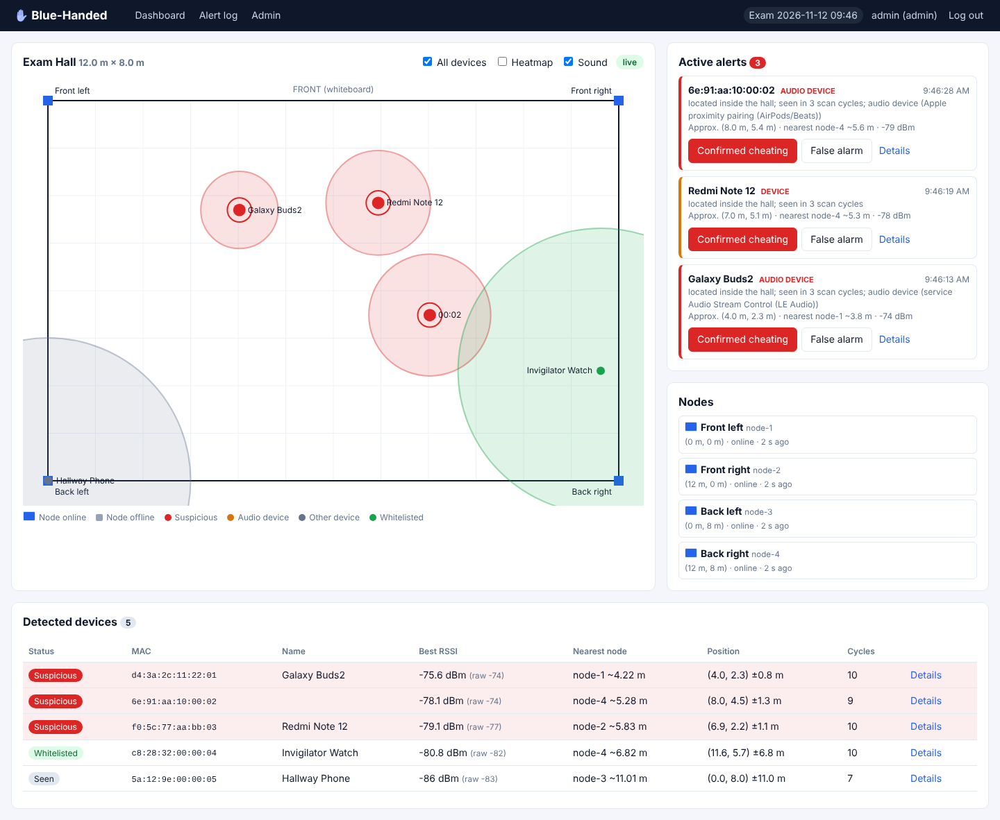

# Step 4: Server and dashboard

**Goal:** understand and run the Raspberry Pi application, on your laptop first (no hardware), then on the Pi.
**Report:** Phase 3–4, sections 5.2.1–5.2.4, flow chart 6.2.1 Raspberry Pi, sequence diagram 6.3.

## 4.1 Run it on your laptop in two minutes

Needs Python 3.11+.

```bash
cd server
python3 -m venv .venv
source .venv/bin/activate            # Windows: .venv\Scripts\activate
pip install -r requirements-dev.txt
python -m bluehanded create-user admin --role admin
python -m bluehanded serve --simulate
```

Open <http://localhost:5000> and log in. `--simulate` skips MQTT and feeds the engine with four fake nodes in the corners of a 12 × 8 m hall and five fake devices:

| Fake device | What should happen |
|---|---|
| Galaxy Buds2 (LE Audio, appears after 5 s) | High-severity alert, red dot near (3.6, 3.2) |
| Unnamed AirPods (Apple proximity pairing, after 20 s) | High-severity alert |
| Redmi Note 12 phone (after 12 s) | Medium alert (it is not an audio device) |
| Invigilator watch, walking slowly | Green, whitelisted, never alerts |
| Hallway phone, outside the left wall | Grey, no alert |

Run the tests:

```bash
python -m pytest            # 33 tests: Kalman, path loss, trilateration, rules, web, Socket.IO
```



## 4.2 How the code is organised

| File | Role | Report |
|---|---|---|
| `bluehanded/__main__.py` | Command line: `serve`, `create-user`, `simulate`, `fit-pathloss` | |
| `config.py` | Reads `config.toml` | |
| `mqtt_ingest.py` | paho-mqtt subscriber for `scan/+` and `status/+`, pushes threshold config to nodes | 5.1.3 |
| `rssi.py` | `Kalman1D`, `PathLossModel`, `fit_path_loss` | 4.3, 4.4 |
| `localization.py` | Weighted least squares + Gauss-Newton multilateration | 4.5 |
| `profiles.py` | Recognises earphones from UUIDs / appearance / Apple data / name | 4.6 |
| `engine.py` | Ties it all together: per-(device, node) Kalman, positions, rules, alerts | 4.6, 6.2.1 |
| `db.py` | SQLite schema and helpers | 5.2.3 |
| `web.py` | Flask routes, login, admin forms, CSV/JSON export, Socket.IO | 5.2.2, 6.1 |
| `templates/`, `static/` | HTML, CSS, dashboard JavaScript, Chart.js, Socket.IO client (served locally, no internet needed) | 5.2.2 |
| `simulator.py` | Fake nodes and devices | testing |

## 4.3 Data flow

1. A node publishes a scan batch. `mqtt_ingest` calls `engine.handle_scan(node_id, payload)`.
2. For each device in the batch, the engine updates the Kalman filter of that (device, node) pair, converts the filtered RSSI to a distance, and stores raw + filtered + distance in `readings`.
3. Every second `engine.tick()`:
   - computes each active device's position from all nodes that heard it in the last `stale_s` seconds,
   - smooths the position, counts scan cycles (persistence), applies the rules,
   - creates an alert the first time a device becomes suspicious in this session,
   - emits `devices`, `nodes` and `alert` events over Socket.IO.
4. The browser redraws the map and plays the alarm on `alert`.
5. The proctor clicks **Confirmed cheating** or **False alarm**. `POST /api/alerts/<id>/verify` stores the verdict, who did it, when, and the note, and broadcasts `alert_update` to every open dashboard.

## 4.4 Database tables

| Table | Holds |
|---|---|
| `users` | dashboard accounts (hashed passwords), role `proctor` or `admin` |
| `sessions` | exam sessions; exactly one is active |
| `nodes` | id, label, x, y, enabled, online, last_seen, ip, firmware |
| `devices` | one row per (session, MAC): name, audio profile, last position, suspicious |
| `readings` | every raw and filtered RSSI with timestamp, node and distance |
| `positions` | position history (one row per device every 5 s), used by the heatmap |
| `alerts` | alert, reason, severity, location, verification status, verifier, note |
| `whitelist` | invigilator devices |
| `settings` | thresholds changed from the dashboard |
| `calibration_points` | distance / mean RSSI pairs from Step 5 |

## 4.5 HTTP and Socket.IO API

| Method | Path | Who | Purpose |
|---|---|---|---|
| GET | `/` | proctor | Live dashboard |
| GET | `/alerts` | proctor | Alert log, all sessions |
| GET | `/device/<mac>` | proctor | Device page with RSSI history |
| GET | `/admin` | admin | Sessions, nodes, thresholds, calibration, whitelist, users |
| GET | `/admin/export/<session>.csv` / `.json` | admin | Export exam log |
| GET | `/api/state` | proctor | Full snapshot (JSON) |
| GET | `/api/device/<mac>/history` | proctor | RSSI history per node |
| GET | `/api/heatmap?minutes=30` | proctor | Position density grid |
| POST | `/api/alerts/<id>/verify` | proctor | `{"verdict": "confirmed" \| "false_alarm", "note": "", "whitelist": false}` |
| GET | `/healthz` | anyone | Liveness check |

Socket.IO events from server: `snapshot` (on connect), `devices` and `nodes` (every second), `alert`, `alert_update`. Only logged-in users can connect. All POSTs require the CSRF token.

## 4.6 On the Pi

Already done in Step 2. The service runs `python -m bluehanded serve` with `config.toml`.

Note: the report lists `eventlet`. It is no longer maintained, so the server uses Flask-SocketIO's threading mode with `simple-websocket`, which handles a handful of dashboard clients easily on a Pi 4. `RPi.GPIO` from the report is not needed because the system uses no GPIO; you can add a buzzer or LED later if you want a physical alarm.

## Done when

`serve --simulate` shows the expected behaviour in the table above, and `pytest` passes.
